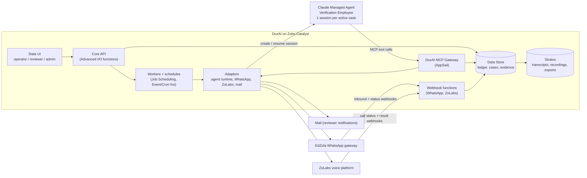
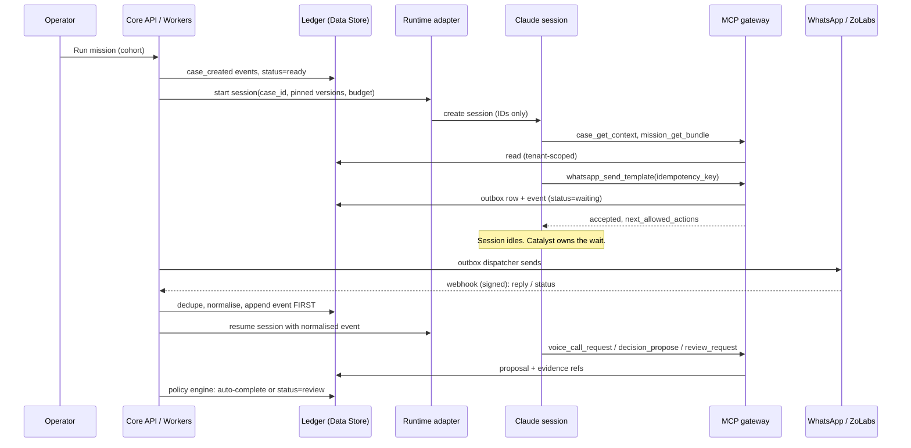

# DozAI Core: Technical Architecture (Sprint 1A/1B)

Status: DRAFT v0.1 for tech-lead review. Owner: Aristo (tech lead).
Sources: the "DozAI Core Team Walkthrough" PDF (locked product decisions) and the clickable prototype (UX reference only).
Where they disagree, the PDF wins. See section 12.

> Items marked **[VERIFY]** are my assumptions about Zoho Catalyst capabilities. Confirm them in the Catalyst docs or a spike before building on them. Spikes are listed in section 11.

---

## 1. What we are building

DozAI is a reusable mission platform. The first mission is the post-program placement and retention tracer. A cohort enters, and each case leaves with evidence, an outcome and a review trail.

The hierarchy, with different rates of change at each level, is:

```
Platform  >  Verification Employee  >  Mission bundle  >  Mission run  >  Case
(tenants,    (reusable AI role,        (questions, policy, (one cohort +    (one participant's
 cases,       versioned)                rubric, templates)  frozen employee   outcome)
 evidence,                                                  + mission ver.)
 audit)
```

**Rule that shapes every design decision:** a second mission must need only a new mission bundle (configuration and skills). It must not need a new case engine. The 34-question instrument is data, not code.

## 2. Design principles

1. **Claude proposes. Catalyst validates and commits.** The agent never holds authoritative state, credentials, or database access.
2. **Ledger first.** Every external event is written to the ledger and outbox before the agent sees it or any side effect runs.
3. **Capabilities, not tables.** The agent gets narrow business tools (MCP), never a query interface.
4. **Workflow status and business outcome are separate fields.** Review is a status, not an outcome.
5. **Every side effect is idempotent**, version-checked and policy-checked.
6. **Minimum data to Claude.** Pseudonymous IDs, no phone numbers and no raw recordings by default.
7. **Channels sit behind adapters** with fake implementations, so Sprint 1A has no live-channel dependency.
8. **Pin everything.** Employee version, mission version and model are frozen per mission run.

## 3. System context



### Responsibility boundaries (from the PDF)

| Component | Owns | Never owns |
|---|---|---|
| DozAI Core | Workflow, state, evidence, policy, review, audit | Model reasoning internals |
| Claude agent | Reasoning, context, tool selection, proposed judgement | Authoritative state, provider credentials |
| Channel services (WhatsApp, ZoLabs) | Delivery, inbound replies, calls, structured results | Mission judgement |
| Human reviewer | Ambiguity, policy exceptions, record corrections, final judgement | Routine orchestration |

## 4. Tooling and stack decisions

| Concern | Choice | Why / notes |
|---|---|---|
| Language | **TypeScript** everywhere (Node 20+) | One language across UI, functions and gateway lets the two devs share types and validation. |
| Repo | One monorepo with npm workspaces | See section 6. |
| Front end | **React + Vite + TypeScript**, hosted on **Catalyst Slate** | The PDF names Slate UI. The prototype is plain JS and gets ported to components. Use TanStack Query for server state, React Router for the 7 views, and plain CSS variables (port `styles.css` tokens). Add a UI kit later if needed. |
| Core API | **Catalyst Advanced I/O functions** (Node/Express style) | Auth, routes, case operations, review actions. |
| Webhooks | Separate Advanced I/O function | Isolated route with raw-body signature verification and fast ack. It writes the event and returns. |
| Workers / schedules | Catalyst **Job Scheduling**, **Cron**, **Event** functions; Catalyst **Signals** if suitable [VERIFY] | Retries, contact-window scheduling, outbox dispatch, session resume. |
| MCP Gateway | **AppSail** (Node + TypeScript + official MCP SDK, Streamable HTTP) | Long-lived HTTP service that Claude's runtime can reach. Holds the tool registry and enforces policy. |
| Data | **Catalyst Data Store** (ZCQL) | Cases, events, evidence, decisions, audit. |
| Files | **Catalyst Stratus** | Transcripts, recordings, audit exports. Referenced by key from Data Store rows. |
| Auth | **Catalyst Authentication** + our own role/tenant table | Roles: admin, agent_ops, operator, reviewer. Participants do not log in. |
| AI runtime | **Claude Managed Agents (beta)** through a **runtime adapter** | The adapter is the only code that calls Anthropic. If the beta API changes, only the adapter changes. |
| WhatsApp | **EdZola WhatsApp gateway** behind `WhatsAppPort` | Template sends, inbound replies, opt-out. |
| Voice | **ZoLabs** (our product) behind `VoicePort` | Call request, status, structured result, transcript link. |
| Mail | Catalyst Mail or Zoho Mail API behind `NotifyPort` | Reviewer and admin notifications only. **Never send to participants or clients automatically.** Per org policy, humans send client mail. |
| Validation | **zod** schemas in `backend/packages/contracts` | Single source for API, MCP tool I/O and webhook payloads. |
| Tests | Vitest (unit), Playwright (UI smoke), contract tests per tool and per adapter | See section 10. |
| CI | GitHub Actions: lint, typecheck, test, build, `catalyst deploy` to staging | Same checks for AI-assisted and human code. Human review before every merge. |

**Model:** pin one Claude model per Verification Employee version. My default suggestion is Sonnet 5.5 for case sessions (cost and latency suit bounded tool use), with Opus 5.5 only for an offline evaluation or judge role. Final choice is decision #5 in section 11.

## 5. Core domain model

### 5.1 Case: status and outcome are separate

```
status:   draft > ready > running > waiting > call_scheduled > calling > evaluating > review > complete
outcome:  confirmed | not_confirmed | inconclusive | opted_out | cancelled   (set only when complete)
```

`cancelled` also covers policy stops that must not be reported as a verified livelihood result.

The participant's livelihood state, an evidence-backed result category, is a separate field from the outcome:

`same_job | changed_job | not_employed | education_training | unreachable_unclear`

NEET is derived (not employed, not in education, not in training). It is not a stored status.

### 5.2 Transitions

All transitions go through one function, `transitionCase(caseId, expectedVersion, event)`. It:
1. checks the transition table (illegal moves throw),
2. checks policy (consent, contact window, attempt cap, opt-out lock),
3. writes the event to the ledger, then updates the projection and increments `version`.

The transition table is a pure, exhaustively tested module in `backend/packages/domain`. Nothing else writes `cases.status`.

### 5.3 Data Store tables (Sprint 1A minimum)

| Table | Purpose | Key fields |
|---|---|---|
| `tenants` | Org isolation | `tenant_id`, name |
| `users` | Maps Catalyst users to role + tenant | `user_id`, `tenant_id`, `role` |
| `employee_versions` | Frozen agent definition | `employee_key`, `version`, `model`, `skill_refs`, `tool_allowlist`, `system_prompt_ref` |
| `missions` / `mission_versions` | Mission bundle: instrument, contact policy, rubric, templates | `mission_id`, `version`, `bundle_json` (immutable once published) |
| `mission_runs` | One cohort run, pinned to versions | `run_id`, `mission_version`, `employee_version`, `budget`, `window` |
| `participants` | Identity and contact (PII lives here only) | `participant_id` (pseudonymous), name, phone (encrypted), language, consent record |
| `cases` | **Current projection** | `case_id`, `tenant_id`, `run_id`, `participant_id`, `status`, `outcome`, `livelihood_state`, `version`, `next_action`, `owner` |
| `case_events` | **Immutable ledger** (append-only) | `event_id`, `case_id`, `seq`, `type`, `actor`, `payload_ref`, `prev_hash`, `hash`, `ts` |
| `evidence` | Structured facts with provenance | `evidence_id`, `case_id`, `question_id`, `value`, `source` (whatsapp/voice/programme_record), `confidence`, `event_id`, `transcript_ref` |
| `interactions` | Messages and calls | `interaction_id`, `channel`, `direction`, `provider_id`, `status`, `case_id` |
| `outbox` | Pending side effects | `outbox_id`, `case_id`, `kind`, `payload`, `idempotency_key`, `status`, `attempts`, `next_attempt_at` |
| `idempotency_keys` | Dedupe for tools and webhooks | `key`, `scope`, `result_ref`, `ts` |
| `decisions` | Agent proposals and human decisions | `decision_id`, `case_id`, `kind` (proposal/final), `proposed_outcome`, `confidence`, `evidence_refs`, `actor` |
| `review_tasks` | Human review queue | `task_id`, `case_id`, `reason`, `assignee`, `status` |
| `agent_sessions` | Session registry and usage | `session_id`, `case_id`, `employee_version`, `tokens_in/out`, `cost`, `budget`, `status` |

Every table carries `tenant_id`. Every query goes through a repository layer that injects it. No raw ZCQL in handlers.

### 5.4 The ledger

- Append-only. No update or delete code path exists for `case_events`.
- Hash chain: `hash = sha256(prev_hash + canonical_json(event))`. "Verify integrity" in the UI recomputes the chain per case.
- Large payloads (transcripts, recordings) go to Stratus. The event stores the reference and a content hash.

## 6. Repository layout

```
dozai/
  frontend/                 # operator web app (plain JS + Vite); built into client/ for Catalyst
    src/lib/                #   data and helpers: api, state, format, dom
    src/components/         #   reusable UI: modal, toast, case panel, controls, question editor
    src/pages/              #   one folder or file per screen
    src/styles/             #   CSS, imported in a fixed order from index.css
  backend/
    functions/
      core_api/             # Express API: src/routes/ has one file per area
      cron_tick/            # scheduler: calls POST /api/jobs/tick
    appsail/
      mcp-gateway/          # MCP server + tool registry
    packages/
      contracts/            # zod schemas: API, MCP tools, webhook payloads, events
      domain/               # case state machine, contact policy (pure TS)
      core/src/             # business rules: missions/, conversation/, agent/, storage/, cases/
      adapters/             # Claude, Interakt WhatsApp, ZoLabs, plus fakes
      catalyst/             # Catalyst data store and sign-in
  scripts/                  # local dev server, bundle and deploy
  docs/                     # decisions, runbooks, project plan
```

**Dependency rule:** `domain` imports nothing but `contracts`. `core` imports `contracts` and `domain`; `adapters` import `core`. Functions and the gateway import `domain`, `core` and `adapters`. The web app imports no backend code at all: it only calls the API. This keeps the case engine free of mission specifics.

## 7. MCP gateway: tool contracts

Every tool returns the standard envelope: `{ operation_id, case_version, next_allowed_actions[], error? }`.

| Tool | Type | Behaviour | Checks |
|---|---|---|---|
| `case_get_context` | Read | Minimal authorised facts and evidence refs for one case | tenant, session-to-case binding |
| `mission_get_bundle` | Read | Questions, contact policy, rubric for the pinned version | session's pinned mission version |
| `case_get_timeline` | Read | Recent ledger events, trimmed | tenant, case binding |
| `whatsapp_send_template` | Action | Enqueue an approved template to the outbox | consent, contact window, attempt cap, opt-out, template allowlist, idempotency key |
| `callback_schedule` | Action | Request a policy-valid future action | window rules, retry cap |
| `voice_call_request` | Action | Enqueue a ZoLabs call | consent, window, one active call per case |
| `decision_propose` | Action | Write a **proposal** with confidence and evidence refs | evidence refs must exist; cannot set a final outcome |
| `review_request` | Action | Create a review task | reason code required |

**Excluded by design:** generic DB query, direct case completion, raw provider API, credential retrieval, arbitrary code execution, open web access.

Gateway rules:
- The session token maps to exactly one `case_id` and `tenant_id`. The tool cannot be pointed at another case.
- Every action tool requires `idempotency_key` and `expected_version`. A stale version returns a structured `VERSION_CONFLICT`, and the agent re-reads.
- Tools never complete a case. Only the policy engine (auto-confirm at or above the threshold with no conflict) or a human does.
- Auth to the gateway uses a service credential held in the Anthropic vault or secret reference, never in prompts.

## 8. Runtime flow for one case



Key mechanics:
- **Webhook handler:** verify the provider signature on the raw body, dedupe by provider event ID, append the ledger event, enqueue "resume session", then return 200. No agent work runs inline.
- **Outbox pattern:** tools write an outbox row. A worker dispatches it to the channel and records the provider ID. Retries are safe because of idempotency keys.
- **Session idling:** the agent is never kept running while waiting. A worker resumes it on a meaningful event.
- **Budgets:** per-session spend cap (prototype assumed $0.50) enforced in the adapter. On breach the session is paused and an alert is raised.
- **Concurrency:** one active session per case, bounded global concurrency (decision #5).

## 9. Channels

**WhatsApp (EdZola gateway):** template-first outreach, then reply handling. Required contract items are the request schema, webhook schema, signature scheme, delivery statuses and opt-out keywords. Opt-out sets `outcome=opted_out`, locks contact, and stops all queued outbox rows for that case.

**ZoLabs voice:** `voice_call_request` creates an outbox row. The adapter calls ZoLabs. ZoLabs sends status webhooks (scheduled, calling, completed, failed) and a structured result (answers keyed by approved `question_id`) plus a transcript link. The transcript is stored in Stratus and only a reference goes into evidence. Since ZoLabs is our own product, agree the contract early: signed webhooks, idempotent call-request IDs, and a cancel endpoint.

**Fake adapters (Sprint 1A):** `FakeWhatsApp` and `FakeVoice` implement the same ports and can replay scripted scenarios (same job, changed job, employer conflict, opt-out, no response). This replaces the prototype's hardcoded simulator.

**Mail:** reviewer-assigned and queue-threshold notifications only.

## 10. Security, data and quality

**Data minimisation to Claude**
- Session input is IDs only. The agent reads authorised facts through `case_get_context`.
- Participant name and phone are not returned. Use first name or a pseudonym only if the rubric needs it, and decide this under data policy (#3).
- Recordings and raw transcripts are not exposed by default. Structured evidence is.

**Our own working rules (EdZola policy)**
- No real beneficiary data, call recordings or transcripts in any Claude Code or Claude chat session. Develop and test on **synthetic cohorts only**.
- No secrets in prompts or the repo. Use Catalyst environment variables and the vault. `.env` is gitignored, and a secret scanner runs in CI.
- Every Claude Code PR needs human review before merge. Tag AI-assisted commits in PR descriptions.

**Platform controls**
- Tenant and role checks in a single middleware plus the repository layer.
- Provider webhook signature verification on the raw body.
- Phone numbers are encrypted at rest. The UI masks them.
- Explicit retention policy for evidence, transcripts and recordings (decision #3).

**Quality gates**
- State machine: exhaustive transition tests plus property tests (no illegal path reaches `complete` without an outcome).
- Gateway: a contract test per tool, including version conflicts, duplicate idempotency keys, opted-out contact and cross-tenant access (must fail).
- Gold cases: 25 or more synthetic cases with expected outcomes drive the agent evaluation. Track agreement between agent proposals and human decisions, unsupported-fact rate and policy violations.
- Pilot exit gate (1B): 25 staging cases complete with **no lost context, no duplicate contact and no unsupported completion**.

## 11. Open decisions and spikes

### Decisions to lock before coding (PDF slide 18), with my recommendation

| # | Decision | Recommendation |
|---|---|---|
| 1 | Instrument: 34 questions, branching, outcome rules, languages | Keep `question_id`s stable. The programme team signs off the wording. English and Hindi, 1B. |
| 2 | Channel contracts | Write OpenAPI/zod contracts for WhatsApp and ZoLabs in week 1. ZoLabs is ours, so co-design it. |
| 3 | Data policy: identifiers, consent basis, retention, what reaches Claude | Pseudonymous `case_id` only to Claude. Retention per programme agreement. Needs the client DPO or programme lead. |
| 4 | Pilot policy: auto-completion, reviewer authority, retries, windows | Auto-confirm at or above 85% with no conflict. Max 3 attempts over 7 days. Contact 09:30-18:00 IST. These match the prototype and need sign-off. |
| 5 | Runtime: model, budget, concurrency, staging | Sonnet 5.5 pinned, $0.50 per session, concurrency 5 in staging. Confirm after the first cost measurements. |
| 6 | Source intake | **CSV first.** Add a Zoho Creator/CRM connector as a mission-bundle input adapter later. |

### Technical spikes for Sprint 1A (do these first, 1 to 2 days each)

1. **Case concurrency on Data Store [VERIFY].** Does Data Store support an atomic conditional update for the `version` check? If not, serialise writes per case (a lock row or single-consumer queue per case) before relying on optimistic locking.
2. **AppSail and Managed Agents reachability.** Can Claude's managed runtime reach the AppSail MCP endpoint (auth, TLS, cold starts)? This is the hardest boundary, so prove it first. Sprint 1A step 3 is exactly this.
3. **Catalyst Signals / Job Scheduling fit [VERIFY].** Can they carry the outbox dispatch and the session-resume jobs with retries and delays, or do we need our own polling worker?
4. **Webhook raw-body access.** Confirm Advanced I/O gives us the raw body for signature checks.
5. **Slate deployment of a Vite app**, plus how auth and the API origin work locally and in CI.

## 12. Reconciling the prototype with the locked decisions

The prototype is a UX reference. Where the PDF differs, build to the PDF.

| Area | Prototype | Locked (PDF) |
|---|---|---|
| Outcomes | Status pills mixing workflow and outcome (Needs review, In progress, Same job...) | Separate `status` (draft...complete) and `outcome` (confirmed, not confirmed, inconclusive, opted out, cancelled) |
| Result categories | Same job, changed job, unemployed | Adds **education or training** and **unreachable/unclear**. NEET is derived. |
| Interview channel | WhatsApp conversation only | WhatsApp prepares and **ZoLabs voice** runs the structured interview |
| Tools | 6 tools | **8 tools**: adds `case_get_timeline` and `voice_call_request` |
| Hierarchy | Mission and case only | Platform > Employee > Mission bundle > **Mission run** > Case |
| Pilot cohort | 184 cases, 12 in pilot | **25-case** pilot is the 1B target. 1A is one case end to end. |
| Frontend | Static vanilla JS | React on Slate, ported view by view |
| Case IDs | `DZ-10xx` | `DV-10xx` appears in the reviewer mock. Pick one format with the product team. |
| Review actions | Confirm / Follow-up / Inconclusive | Reviewer mock shows **Approve edit / Request rework** for record conflicts. Support both. |
| Claude session UI | Scripted | Real event timeline from `agent_sessions` plus ledger |

## 13. Delivery plan and team split

You lead. Two developers build. Split by seam, not by layer, so each owns an area end to end and the shared contracts stay small.

**Week 0 (you, plus both devs pairing):** lock contracts, run spikes 1, 2 and 4, set up the repo, CI and Catalyst projects (dev and staging).

**Sprint 1A: walking skeleton**

| Step | Outcome | Owner |
|---|---|---|
| 1. Foundation | Catalyst project, auth, tenant, roles, minimal Slate shell, `/health`, CI deploy | Dev A |
| 2. Ledger | Tables, `transitionCase`, hash-chained events, evidence, repositories, case list and detail API | Dev A |
| 3. Claude + MCP | Runtime adapter, AppSail gateway with `case_get_context`, `mission_get_bundle`, `decision_propose` and one mocked action, pinned session | Dev B |
| 4. Visible trace | Session and ledger timeline UI showing event, tool call and proposed outcome | Dev B, with Dev A on the API |

**Demo gate:** a synthetic case reaches a proposed decision. The agent used only MCP tools, there was no direct DB access, and no live channel was involved. The timeline shows the event, the tool call and the proposal.

**Sprint 1B:** WhatsApp and ZoLabs adapters (real), the 34-question bundle and rubric, the review workspace, cohort dashboard, duplicate-contact safety, budgets, evaluation and audit export.

**Working agreements for the team**
- Contracts first: change `backend/packages/contracts` in its own small PR so both devs unblock each other.
- One ticket = one acceptance test. The ticket list is derived from section 13.
- ADRs in `docs/adr/` for any deviation from this document.
- Weekly architecture review (30 minutes). Bring spike results and blockers.

## 14. Immediate next steps

1. Review this document. Mark the sections you want to change.
2. Run the five spikes (section 11) and record results in `docs/adr/`.
3. Lock decisions 1 to 6 with the programme and product team.
4. Convert section 13 into tickets with owners and acceptance tests.
5. Scaffold the monorepo (needs the Catalyst CLI installed and a Catalyst project created, since I can't run `catalyst login` here).
